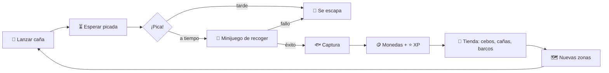
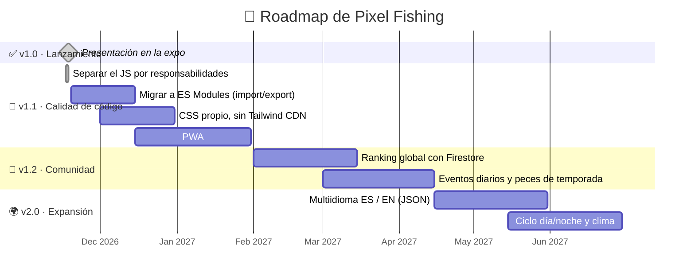

<div align="center">

# 🎣 Pixel Fishing

**Juego de pesca en pixel art hecho con HTML, CSS y JavaScript puro. Sin frameworks de JS, sin motores, sin imágenes: todo se dibuja y suena desde código.**


[▶️ **Jugar online**](https://TU-USUARIO.github.io/the-fishing-game/) · [🗺️ Roadmap](#-roadmap) · [🧠 Qué demuestra](#-qué-demuestra-este-proyecto) · [📚 Guía para explicarlo](docs/EXPLICACION.md)

<!-- Añade aquí una captura o GIF:  -->

</div>

---

## 🎮 ¿De qué va?

Lanza la caña, espera la picada, **pulsa en el momento justo** y gana el minijuego de recoger. Vende tus capturas, mejora tu equipo y viaja a zonas cada vez más difíciles en busca de peces legendarios.



### ✨ Características

| | |
|---|---|
| 🐟 **21 peces** | 4 rarezas: ⚪ Común · 🔵 Raro · 🟣 Épico · 🟡 Legendario |
| 🗺️ **5 zonas** | Muelle, Pantano, Aguas Profundas, Fiordos Noruegos, Arrecife Tropical |
| 🛶 **3 vehículos** | A pie → Bote → Barco pesquero (cada uno desbloquea zonas) |
| 🎣 **3 cañas · 3 cebos** | Bambú / Fibra / Carbono · Pan / Gusano / Pulpito |
| 🏆 **8 logros** | Con recompensa en monedas |
| 🔥 **Rachas y regalo diario** | Hasta +100 % de monedas por racha; recompensa por días seguidos |
| 🎨 **Personalización** | Colores de caña, carrete, línea, boya y agua |
| 💾 **Guardado** | Local (`localStorage`) + nube (Firebase), gana siempre la partida más reciente |
| 📖 **Tutorial integrado** | Pantalla «Cómo jugar» para quien lo prueba por primera vez |
| 🔊 **Sonido sintetizado** | Efectos y ambiente con la Web Audio API, sin archivos de audio; se recuerda tu preferencia |

### 🕹️ Controles

| Acción | PC | Móvil |
|---|---|---|
| Lanzar / tirar / recoger | `Espacio` o clic | Toque en el botón |
| Cerrar captura | `Espacio` | Botón *Guardar* |

En el minijuego, pulsa cuando la marca blanca esté dentro de la **zona verde**. Cuanto más rara la pieza, más aciertos necesitas (1 a 4).

---

## 🗺️ Roadmap



| Versión | Estado | Objetivo |
|:---:|:---:|---|
| **v1.0** | ✅ Hecha | Juego completo y jugable: pesca, tienda, zonas, logros, guardado |
| **v1.1** | 🔜 Siguiente | Código más mantenible, funcionar offline, cero dependencias de CSS externas |
| **v1.2** | 📅 Planificada | Competir con otros jugadores y razones para volver cada día |
| **v2.0** | 💡 Idea | Llegar a más público y dar vida al mundo del juego |

---

## 🧠 Qué demuestra este proyecto

| Concepto | Dónde se ve |
|---|---|
| **DOM y eventos** | Menús modales, tienda y mochila generados dinámicamente; teclado, ratón y táctil |
| **Canvas 2D** | Escena animada a 60 fps con `requestAnimationFrame`: cielo, agua, caña curva, boya |
| **Pixel art generado por código** | Los peces nacen de plantillas de texto que se pintan píxel a píxel en un `<canvas>` |
| **Web Audio API** | Osciladores y ruido filtrado para sonidos y ambiente, sin ficheros |
| **JSON + `localStorage`** | Guardado, migración y reparación de partidas antiguas |
| **Asincronía** | `async/await`, `Promise.race` con *timeout* para no bloquear si falla la red |
| **Backend as a Service** | Firebase Auth anónima + Firestore, con *fallback* a modo local |
| **CSS moderno** | Variables, `grid`, animaciones, `dvh`, *media queries*, `prefers-reduced-motion` |
| **Máquina de estados** | `IDLE → WAITING → HOOKED → FIGHT` controla toda la pesca |

---

## 🚀 Cómo ejecutarlo

```bash
git clone https://github.com/TU-USUARIO/the-fishing-game.git
cd the-fishing-game
```

Abre `index.html` con la extensión **Live Server** de VS Code, o súbelo a **GitHub Pages** (*Settings → Pages → Deploy from branch → main*).

> ⚠️ Actualmente necesita conexión a internet para cargar Tailwind (CDN), la fuente *Press Start 2P* y Firebase. Si no hay nube, el juego sigue en modo local. Quitar la dependencia de Tailwind es parte de la v1.1.

```
the-fishing-game/
├── index.html        # Estructura (HTML), menús e inicio de Firebase
├── style.css         # Estilos pixel art propios
├── js/
│   ├── data.js       # Datos: peces, cañas, zonas, logros + sprites
│   ├── state.js      # Estado de la partida y máquina de estados
│   ├── audio.js      # Sonido con Web Audio API
│   ├── storage.js    # Guardado local (localStorage) y nube (Firebase)
│   ├── render.js     # Dibujo de la escena en <canvas>
│   ├── fishing.js    # Lógica de pesca, minijuego y capturas
│   ├── ui.js         # HUD, menús, tienda, mochila, viajes, logros
│   └── main.js       # Arranque y eventos iniciales
├── docs/EXPLICACION.md   # Guía para presentar el proyecto
└── README.md
```

---

## 🔐 Seguridad (Firebase)

La `apiKey` de una app web de Firebase **no es secreta**, pero entonces las **reglas de Firestore son obligatorias**. Cada jugador solo debería poder leer y escribir su propia partida:

```
rules_version = '2';
service cloud.firestore {
  match /databases/{database}/documents {
    match /pixelFishing/{uid} {
      allow read, write: if request.auth != null && request.auth.uid == uid;
    }
  }
}
```

Además, en la consola de Firebase hay que tener activado **Authentication → Método de acceso → Anónimo**.

---

<details>
<summary>🛠️ <b>Registro de cambios</b></summary>

### v1.1.0
- **Código dividido en 8 archivos** por responsabilidad (`js/`), con cabecera explicativa en cada uno.
- **Tutorial «Cómo jugar»** accesible desde el menú principal.
- **El sonido se recuerda** entre sesiones.
- **No se guarda hasta haber cargado la partida**, para no pisar el progreso.
- Guía para presentar el proyecto en `docs/EXPLICACION.md`.

### v1.0.1

**Arreglado**
- El HTML enlazaba `pixel_fishing.css`, que no existe: ahora carga `style.css` y se ven los estilos pixel art.
- Los selectores de color de *Personalizar* no tenían eventos asociados y no hacían nada.
- Salir al título con la caña lanzada dejaba temporizadores activos y el juego volvía en un estado inconsistente.
- Mantener `Espacio` pulsado encadenaba acciones (cerraba la captura y lanzaba otra caña al instante).
- Se podía cambiar caña, vehículo o zona con la caña lanzada y pescar en una zona distinta a la que se veía.
- Si la rareza sorteada no estaba disponible con tu cebo, se elegía al azar entre todas; ahora baja a la rareza inmediata inferior.
- Se podía pulsar *Iniciar* antes de terminar la carga y la partida de la nube podía pisar el progreso.
- Una partida local corrupta bloqueaba el arranque.
- La partida de la nube sobrescribía siempre la local aunque fuera más antigua: ahora gana la más reciente (`savedAt`).
- El estado de la nube se quedaba en «Conectando…» si fallaba.
- Faltaba `</html>`.

**Mejorado**
- Metadatos (`description`, `theme-color`), favicon, `aria-label` en los botones «X», foco visible con teclado, `prefers-reduced-motion` y scroll táctil en los menús.
- README con diagramas y roadmap.

</details>

<div align="center">

**👤 Autor:** _Tu nombre_ · Proyecto de 2.º DAW

</div>
